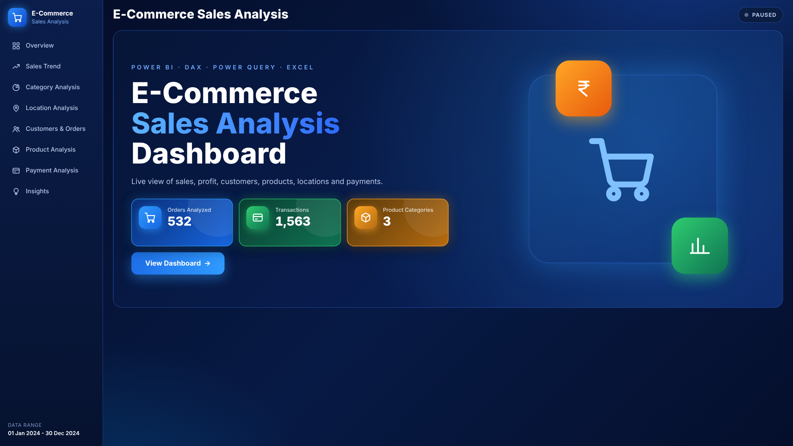
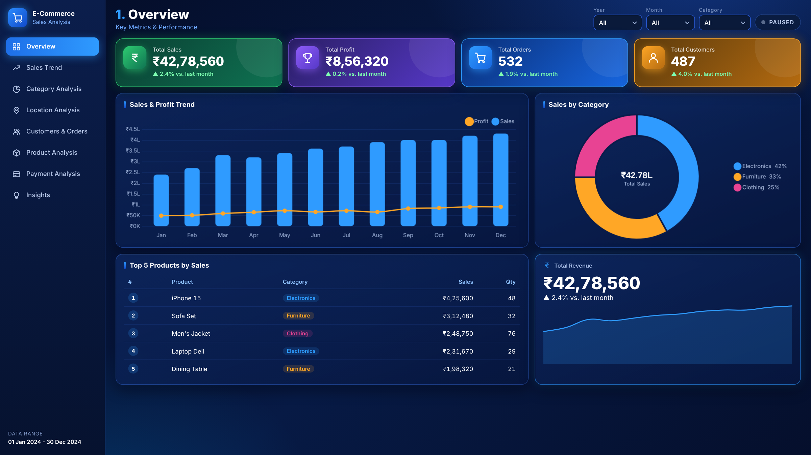
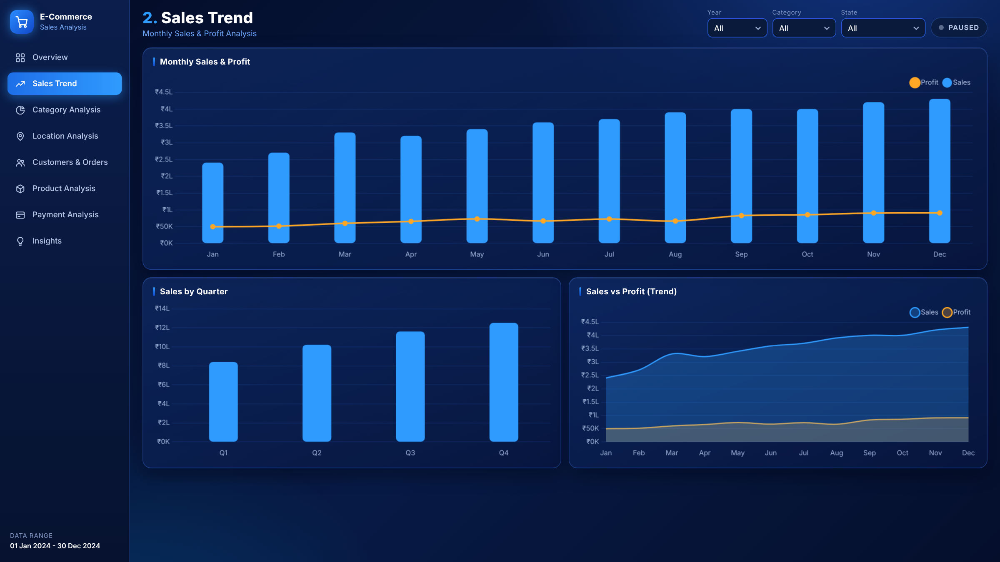
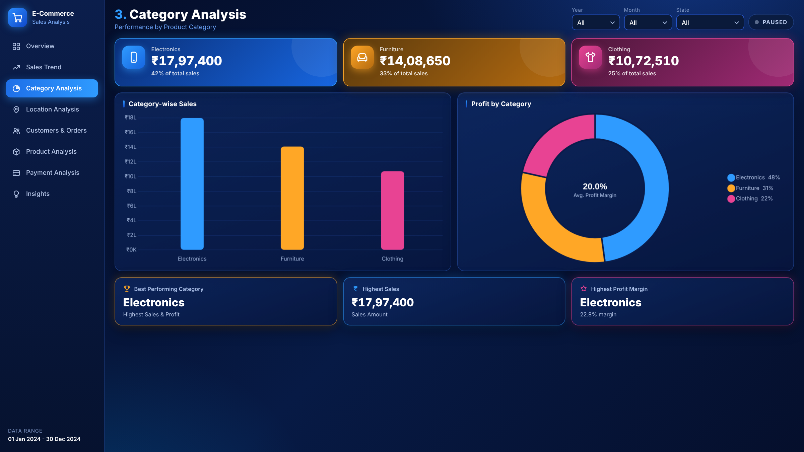
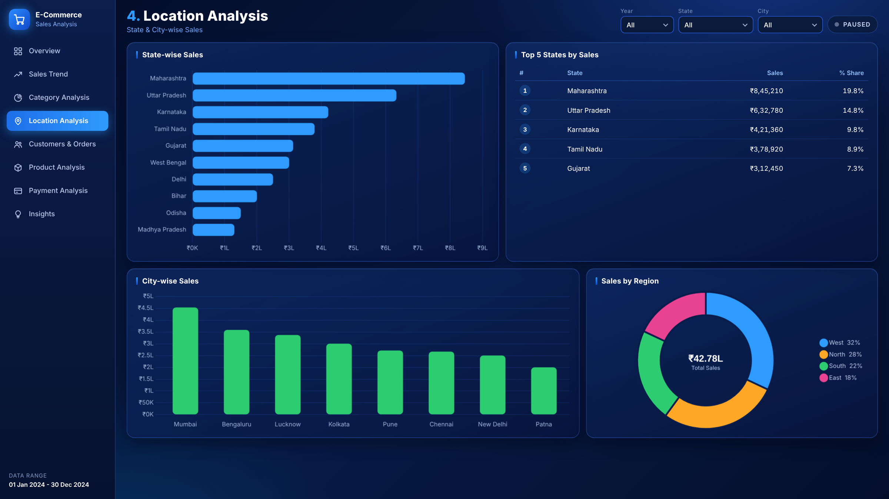
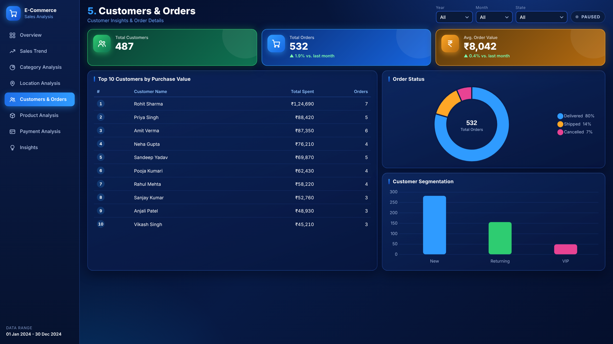
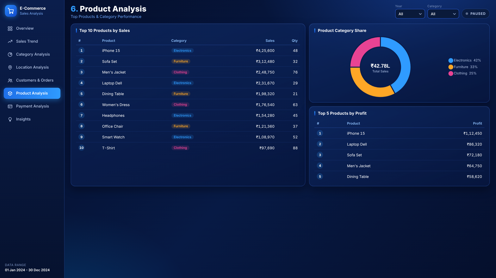
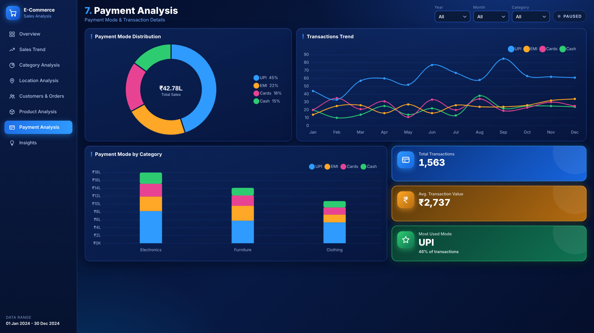
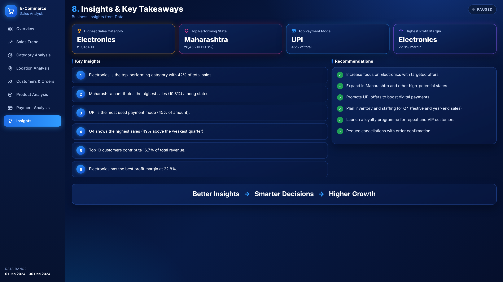
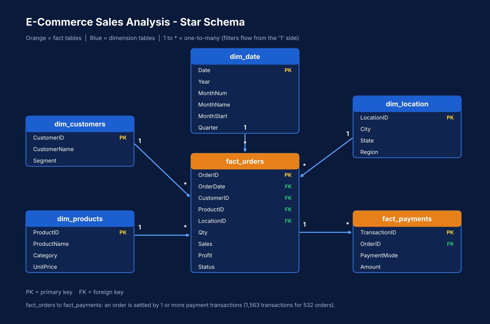

# E-Commerce Sales Analysis Dashboard


An end-to-end sales analytics project: raw CSV data, cleaned and modelled with **Power Query**, analysed with **DAX**, and presented as a 9-page dark-themed **Power BI** dashboard. The same design is also included as an interactive HTML dashboard with filters and a simulated live order feed.

> The data is **synthetic sample data** (01 Jan 2024 - 31 Dec 2024). No real customers or transactions are used.

## Preview

| Cover | Overview | Sales Trend |
|---|---|---|
|  |  |  |

| Category Analysis | Location Analysis | Customers & Orders |
|---|---|---|
|  |  |  |

| Product Analysis | Payment Analysis | Insights |
|---|---|---|
|  |  |  |

> Previews are renders of the interactive web version of the dashboard design. Replace them with screenshots from your own Power BI Desktop (same file names) if you want the README to show the `.pbix` itself.

## Business questions answered

- How much did we sell, how much profit did we make, and how is it changing month to month?
- Which categories, products, states and cities drive revenue and margin?
- Who are the top customers, and how are customers split (New, Returning, VIP)?
- Which payment modes do customers use, and how does that differ by category?
- What should the business do next? (Page 8: insights and recommendations)

## Headline results (sample data)

| Metric | Value |
|---|---|
| Total sales | ₹42,78,560 |
| Total profit | ₹8,56,320 (20.0% margin) |
| Orders / customers | 532 / 487 |
| Average order value | ₹8,042 |
| Payment transactions | 1,563 |
| Top category | Electronics (42% of sales, 22.8% margin) |
| Top state | Maharashtra (19.8% of sales) |
| Top payment mode | UPI (45% of amount) |

Full list of insights and recommendations: [`docs/business_insights.md`](docs/business_insights.md)

## Dashboard pages

| # | Page | What it shows |
|---|---|---|
| 0 | Cover | Title, headline counts, navigation |
| 1 | Overview | KPI tiles with month-on-month growth, sales and profit trend, sales by category, top 5 products |
| 2 | Sales Trend | Monthly sales and profit, sales by quarter, sales vs profit trend |
| 3 | Category Analysis | Sales and profit by category, best category, highest margin |
| 4 | Location Analysis | State-wise and city-wise sales, top 5 states, sales by region |
| 5 | Customers & Orders | Top 10 customers, order status, customer segments |
| 6 | Product Analysis | Top 10 products, category share, top 5 by profit |
| 7 | Payment Analysis | UPI / EMI / Cards / Cash split, transaction trend, payment mode by category |
| 8 | Insights | Auto-generated key insights and recommendations |

## Tech stack

| Tool | Used for |
|---|---|
| Power BI Desktop | Data model, report, theme |
| Power Query (M) | Cleaning, merging, date table |
| DAX | 109 measures, 30 calculated columns |
| Excel | Cleaned dataset with formula-driven KPI summary |
| HTML, CSS, JavaScript (Chart.js) | Interactive web version of the dashboard |

## Data model

Star schema: two fact tables and four dimensions.



| From (many) | To (one) |
|---|---|
| `fact_orders[CustomerID]` | `dim_customers[CustomerID]` |
| `fact_orders[ProductID]` | `dim_products[ProductID]` |
| `fact_orders[LocationID]` | `dim_location[LocationID]` |
| `fact_orders[OrderDate]` | `dim_date[Date]` |
| `fact_payments[OrderID]` | `fact_orders[OrderID]` |

Column-level details: [`docs/data_dictionary.md`](docs/data_dictionary.md)

## Project structure

```
Ecommerce-Sales-Analysis-Dashboard/
├── data/
│   ├── raw/                        orders, customers, products, locations, payments (CSV)
│   └── processed/                  ecommerce_sales_clean.xlsx
├── power_query/                    01_clean_orders.m ... 04_dim_date.m
├── dax/                            measures.dax, calculated_columns.dax
├── powerbi/
│   ├── Ecommerce_Sales_Dashboard.pbip
│   ├── Ecommerce_Sales_Dashboard.SemanticModel/   tables, relationships, measures (TMDL)
│   ├── Ecommerce_Sales_Dashboard.Report/          pages and visuals (PBIR)
│   └── theme/dark_blue_theme.json
├── web/                            interactive HTML version of the dashboard
├── assets/                         page backgrounds, icons, navigation
├── screenshots/                    dashboard page previews
├── docs/                           data dictionary, data model, business insights
├── README.md
├── LICENSE
└── CHANGELOG.md
```

## How to run

### Power BI

1. Install **Power BI Desktop** (Windows).
2. Open `powerbi/Ecommerce_Sales_Dashboard.pbip` (double-click).
3. Click **Refresh now** on the yellow banner, then **Home > Refresh**.
4. Optional: **File > Save as** to get a `.pbix` file.

The data is embedded in the model, so no data source setup is needed. To load the CSV files from disk instead, use the scripts in `power_query/` and set the `DataFolder` parameter to the full path of `data/raw/` (ending with a slash).

More details: [`powerbi/README.md`](powerbi/README.md)

### Web version

Open `web/E-Commerce_Sales_Analysis_Dashboard.html` in any modern browser (internet needed to load Chart.js and fonts). Use the dropdowns to filter. The **LIVE** button adds simulated orders every few seconds.

## DAX highlights

- Month-on-month growth without a date-intelligence function, using `VAR` plus `CALCULATE` on `dim_date[MonthStart]`.
- Top-N flags with `RANKX` calculated columns, used as visual filters.
- Dynamic insight sentences built from measures, so the Insights page changes with filters.
- Indian-style currency labels (₹, Lakh) through format strings and text measures.

## Known limitations

- Sample data only, one year of history.
- Power BI cannot reproduce every effect of the web version (rank badges, rounded bars, live feed).
- Indian digit grouping (₹42,78,560) is not supported by Power BI format strings; amounts show as ₹4,278,560.
- Near real-time data needs a live source (database, DirectQuery or streaming); see `powerbi/README.md`.

## Roadmap

- Connect to a real orders database with scheduled refresh.
- Add a forecasting page (next 3 months).
- Add row-level security by region.
- Add a returns and refunds analysis.

## License

Released under the MIT License. See [`LICENSE`](LICENSE).

## Author

**YOUR NAME**
[LinkedIn](https://www.linkedin.com/in/YOUR-PROFILE) · [GitHub](https://github.com/YOUR-USERNAME) · your.email@example.com
